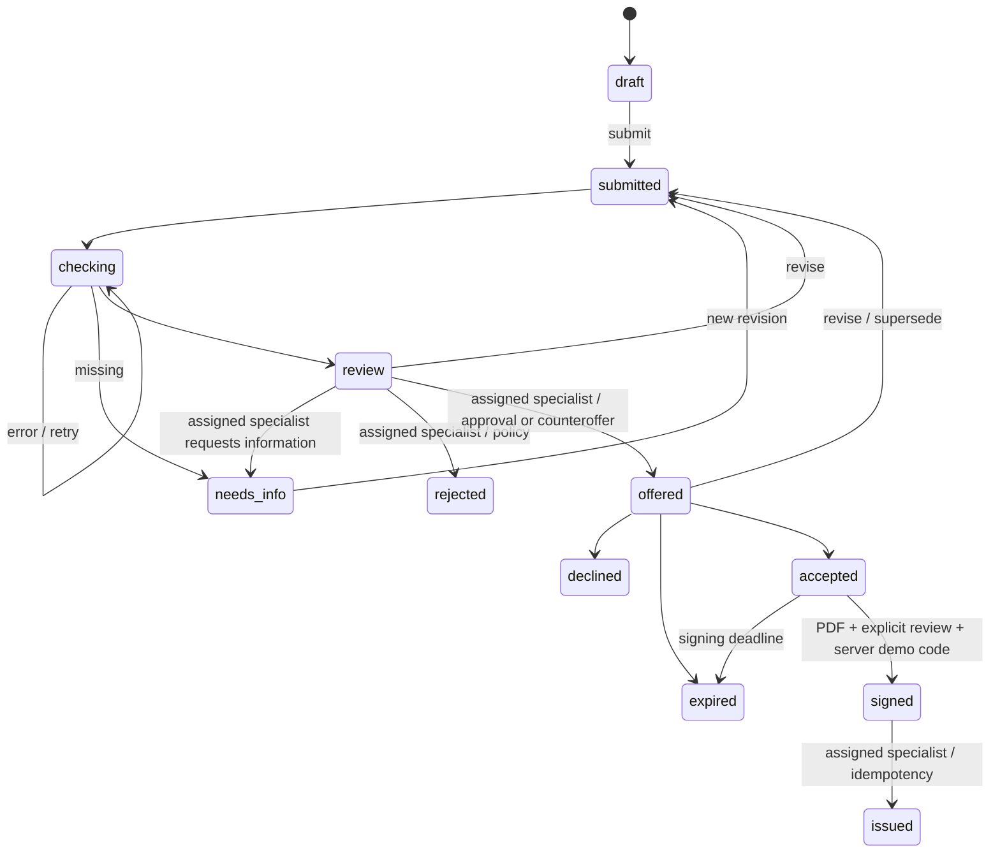
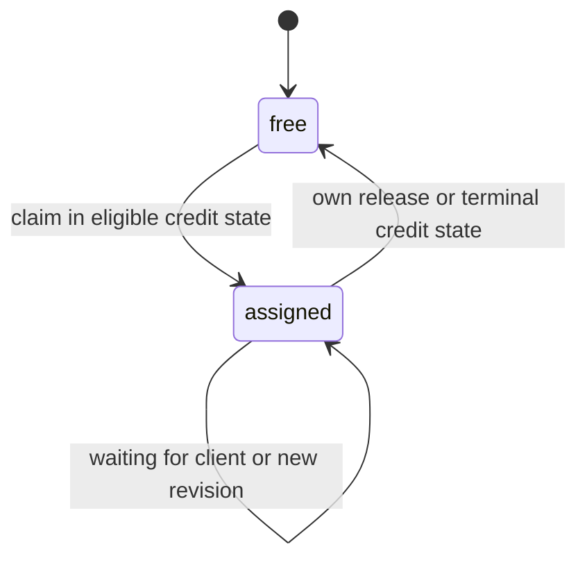

# Архитектура и состояния

Действующий [стек](stack.md), [контракт frontend](frontend-integration.md) и [интерфейс](frontend.md) дополняют этот документ. Frontend — React/TypeScript strict/Vite, Core Components, CSS Modules/Grid/Flexbox/медиазапросы, React Router, TanStack Query, RHF/Zod; Nginx обеспечивает один origin. Backend — Python/Django/DRF/PostgreSQL; sessions/HttpOnly/CSRF, drf-spectacular/OpenAPI/Swagger; Docker Compose, pytest/pytest-django, Vitest/Playwright.

Django — модульный монолит. `api` определяет HTTP/сериализаторы/OpenAPI; предметные приложения хранят ORM-модели. `applications/services.py` и `agreements/services.py` выполняют действия; `checks/adapters.py` — локальные моки; `decisions/policy.py` — скоринг и отдельная кредитная политика; `products/calculations.py` — единый расчёт платежа.

`products/presentation.py` раскрывает стоимость и сравнивает исходный запрос с предложением по зафиксированной ревизии/графику, а не живому каталогу. `applications/readiness.py` объясняет заполненность без изменения условий отправки. Источники каталога, учебная ставка и сохранение старых договоров описаны в [продуктовых улучшениях](product-research.md); состояния процесса ниже не изменены.

Действие проверяет права, берёт `select_for_update` на заявку, сравнивает `lock_version` и сохраняет переход, связанную запись и событие в одной транзакции. Моки синхронные и локальные. Реальные сетевые адаптеры в будущем должны выполняться вне транзакции с повторной проверкой ревизии после ответа. Новая ревизия сохраняет старую историю и помечает непринятое предложение `superseded`.

PDF и кодовое подтверждение — отдельные сущности, не дополнительные кредитные статусы. `AgreementDocument` хранит неизменяемые байты, снимок сторон/условий, версии и отдельный `pdf_sha256`; `document_hash` остаётся хешем условий. Подготовка и compare-and-save выполняются короткими транзакциями, WeasyPrint — ограниченным дочерним процессом без блокировки заявки и без сетевых ресурсов. `SignatureAttempt` привязана к пользователю/компании/конкретному документу; только успешная проверка создаёт `SignatureConfirmation` и переводит accepted → signed. Отдельная копия с демо-отметкой не меняет оригинал. Выдача остаётся действием назначенного специалиста. API 1.3 и подробности хранения: [agreements.md](agreements.md).

Queryset ограничивает доступ компанией пользователя; отдельные can_submit/can_sign проверяются сервером. Специалист — самостоятельная роль, выдача доступна ей. Сессия Django использует HttpOnly/SameSite cookie и CSRF, включая login. Swagger UI поставляется через sidecar и WhiteNoise без обязательного CDN. React использует тот же origin через Vite proxy либо Nginx; формы/кеш изолированы по пользователю и очищаются при смене учётной записи.

Назначение — ортогональное состояние: `free → assigned_to=current specialist → free`, не новый кредитный статус. Claim/release блокируют ту же строку и увеличивают lock_version без изменения status_changed_at; повтор собственного claim с актуальной версией не меняет данные. checking/review/needs_info/offered/accepted/signed допускают назначение. Уточнение, решение, банковский повтор проверки и новая выдача требуют исполнителя. Ожидание клиента/новая ревизия сохраняют назначение; issued/rejected/declined/expired освобождают с событием. Клиентские действия не блокируются назначением.

Очередь — отдельный сериализатор и коррелированные подзапросы по максимальному revision_no; история не загружается, количество SQL не растёт с числом строк. Карточка возвращает available_actions с безопасными причинами; сервисы проверяют условия повторно. Assessment хранит checks_attempt: решение запрещено по другой/неполной попытке или оценке, созданной раньше результатов проверок.

## Демонстрационные допущения

- Период финансов — месяц. Поток = выручка − расходы; лимит платежа = max(0, 50% потока − текущие платежи).
- Негативные проверки ведут к отказу, недостаток данных — к уточнению, техническая ошибка — к повтору.
- Демо-скор: 10 при негативной проверке, 60 при неположительном потоке/существенных обязательствах, иначе 90. Факторы и версия сохраняются. Итоговая политика отдельно проверяет платёж.
- Платёж укладывается в лимит — одобрение; иначе предлагается меньшая сумма. Сумма ниже минимума продукта — отказ.
- Актуальный каталог новых предложений: 300 тыс.–30 млн ₽, 12–60 месяцев, учебная ставка 27%. Публичный ориентир «от 23,5%» не используется вместо учебной ставки. Исторические снимки условий не пересчитываются; источники и ограничения — [product-research.md](product-research.md).
- Аннуитет по номерам месяцев, годовая ставка / 12, без комиссий и календарных особенностей. Decimal, ROUND_HALF_UP до копеек; последний платёж корректирует остаток. Реальный банковский график не заявляется.
- Предложение принимается в течение 7 дней, условная подпись — за 3 дня после принятия. После подписи срок принятия не отменяет моделируемую выдачу.
- Один договор — одна полная выдача; тот же ключ и договор возвращают прежний результат. Новый ключ после выдачи или прежний ключ с другим договором дают 409.

Необязательный «Помощник по кредиту» работает через Django API пошагового сценария и OpenAI-совместимый endpoint. Внешние банковские системы, SMS/email и платные API для помощника не требуются. Реальный банковский режим не включается переключателем DEMO_MODE.

`assistant` — модуль того же Django-приложения, не отдельный сервис. Модель выбирает read-only инструменты и ключи объяснений; сервер проверяет JSON, права, источники и версии, формирует итоговый текст/факты. Сетевой вызов выполняется вне транзакции; при сохранении повторно проверяются версия заявки, диалога и полномочия. PostgreSQL также хранит общую квоту workers. Предложение черновика переносится в штатную форму только после preview и подтверждения, банковские действия модели недоступны. Подробности и ограничения: [assistant.md](assistant.md).

Рекомендуемый профиль: OpenRouter с конкретным открытовесным `:free` slug, строгой поддержкой параметров и нулевыми ценовыми пределами. Без ключа/при недоступности используется отдельный локальный Ollama с Qwen3-4B; на машине владельца он слушает loopback, использует Metal и выгружается после простоя. URL/ключ/модель сменяемы; весов и ключей в образах/репозитории нет. Настоящий локальный маршрут проверен отдельно от cloud: [assistant-live-verification.md](assistant-live-verification.md).

Текущий релиз не включает прогноз денежных потоков, Grade A–E, банковский SLA, сложную приоритизацию и отчётность. risk_level остаётся low/medium/high; начало текущего состояния — status_changed_at. Помощник необязателен: при отключённой модели кредитный процесс продолжает работать.
