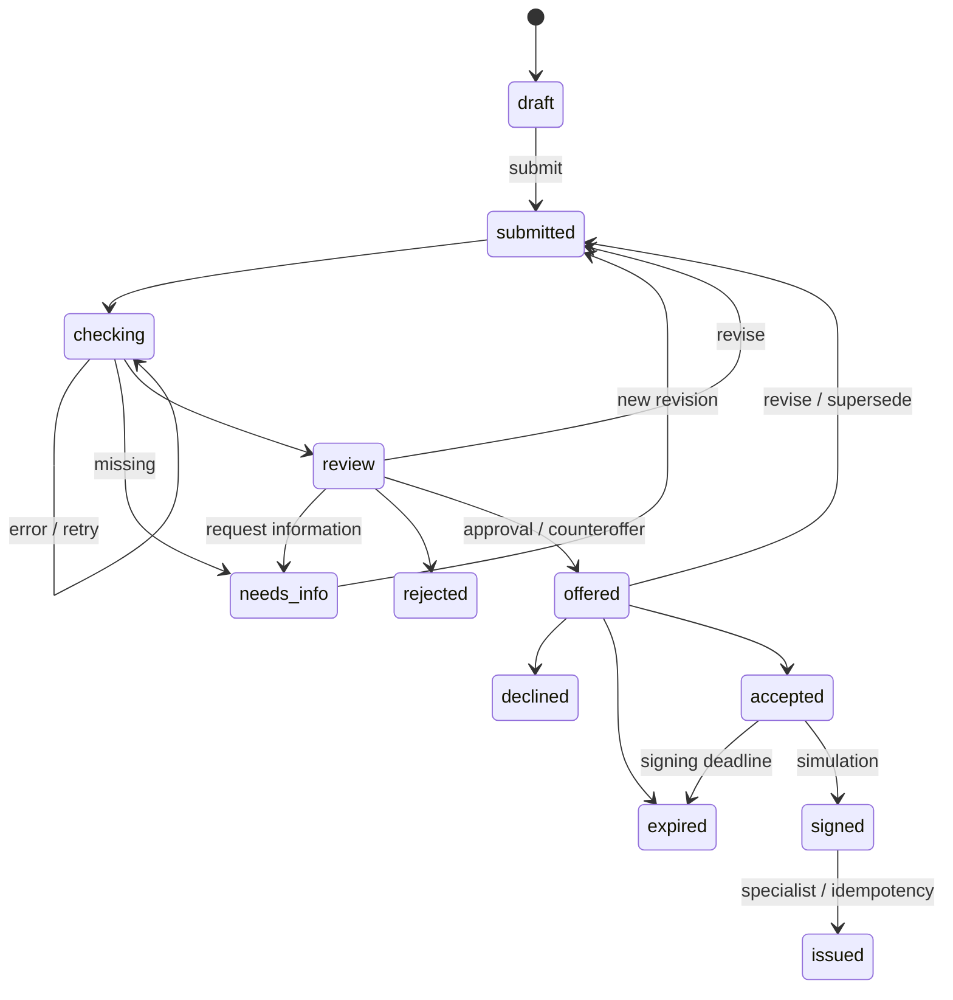

# Архитектура и состояния

Django — модульный монолит. `api` определяет HTTP/сериализаторы/OpenAPI; предметные приложения хранят ORM-модели. `applications/services.py` и `agreements/services.py` выполняют действия; `checks/adapters.py` — локальные моки; `decisions/policy.py` — скоринг и отдельная кредитная политика; `products/calculations.py` — единый расчёт платежа.

`assistant` хранит диалоги и вызывает необязательный OpenAI-совместимый endpoint модели с открытыми весами. Для OpenRouter задан явный список бесплатных моделей, затем необязательный независимый резерв в локальной Ollama; при 429 облачный маршрут временно пропускается. При сбое второго вызова модельного цикла ответ собирается из уже полученных серверных фактов. Каждый запрос повторно проверяет владельца диалога и активное членство в компании. Модели доступны только read-only инструменты: профиль компании, каталог, серверный расчёт платежа, статус привязанной заявки и предложение полей черновика. Последнее сохраняется в сообщении для подтверждения клиентом и не меняет `Application`. Ответ модели ограничен по длине, контексту и вызовам инструментов; числовые факты выдаются структурированно из сервера. Сетевые вызовы модели выполняются вне транзакции, а пара сообщений записывается атомарно после повторной проверки версии диалога. При `AI_ENABLED=false` кредитный процесс не зависит от модели. Помесячного финансового прогноза пока нет.

Действие проверяет права, берёт `select_for_update` на заявку, сравнивает `lock_version` и сохраняет переход, связанную запись и событие в одной транзакции. Моки синхронные и локальные. Реальные сетевые адаптеры в будущем должны выполняться вне транзакции с повторной проверкой ревизии после ответа. Новая ревизия сохраняет старую историю и помечает непринятое предложение `superseded`.

Queryset ограничивает доступ компанией пользователя; отдельные can_submit/can_sign проверяются сервером. Специалист — самостоятельная роль, выдача доступна ей. Сессия Django использует HttpOnly/SameSite cookie и CSRF, включая login. Swagger UI поставляется через sidecar и WhiteNoise без обязательного CDN. React в дальнейшем использует тот же origin.

## Демонстрационные допущения

- Период финансов — месяц. Поток = выручка − расходы; лимит платежа = max(0, 50% потока − текущие платежи).
- Негативные проверки ведут к отказу, недостаток данных — к уточнению, техническая ошибка — к повтору.
- Демо-скор: 10 при негативной проверке, 60 при неположительном потоке/существенных обязательствах, иначе 90. Факторы и версия сохраняются. Итоговая политика отдельно проверяет платёж.
- Платёж укладывается в лимит — одобрение; иначе предлагается меньшая сумма. Сумма ниже минимума продукта — отказ.
- Условные продукты: оборотные средства 100 тыс.–5 млн ₽, 6–36 месяцев, 18%; оборудование 200 тыс.–10 млн ₽, 12–60 месяцев, 16%. Это параметры демо, а не предложения банка.
- Аннуитет по номерам месяцев, годовая ставка / 12, без комиссий и календарных особенностей. Decimal, ROUND_HALF_UP до копеек; последний платёж корректирует остаток. Реальный банковский график не заявляется.
- Предложение принимается в течение 7 дней, условная подпись — за 3 дня после принятия. После подписи срок принятия не отменяет моделируемую выдачу.
- Один договор — одна полная выдача; тот же ключ и договор возвращают прежний результат. Новый ключ после выдачи или прежний ключ с другим договором дают 409.

ИИ, внешние банковские системы, SMS/email, документы и платные API для этого backend не требуются. Реальный банковский режим не включается переключателем DEMO_MODE.
