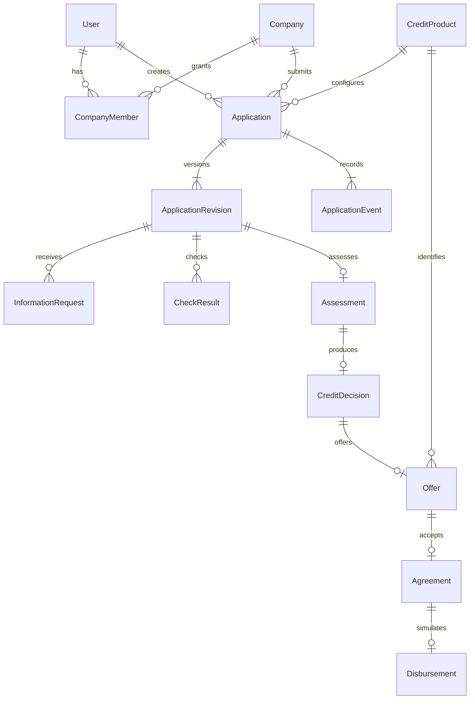

# Модель данных

Предметные идентификаторы — UUID. Денежные колонки — `NUMERIC(18,2)`, ставка — `NUMERIC(7,4)`, срок — месяцы, timestamps — timezone-aware UTC. API возвращает деньги десятичными строками. ИНН — строка; seeds используют заведомо синтетические номера.

| Модель | Поля и ограничения |
|---|---|
| User | UUID, username unique, system_role client/specialist, is_active. is_staff управляет Admin, а не кредитными действиями |
| Company | inn unique, name, kind, registered_at, status, is_existing_client, demo_scenario |
| CompanyMember | user/company PROTECT, unique(user,company), role, can_submit, can_sign, active |
| CreditProduct | code unique, min/max_amount, min/max_term_months, annual_rate, rules_version, active. CHECK границ и ставки 0–100% |
| Application | company/product/created_by PROTECT, status, lock_version, timestamps. Индексы очереди и списка компании |
| ApplicationRevision | unique(application,revision_no), amount/term/purpose, monthly_revenue/expenses/debt_payments, submitted_at, input_snapshot. CHECK положительных условий и неотрицательных финансов |
| InformationRequest | revision, requested_by, question, response_revision OneToOne nullable, responded_at |
| CheckResult | unique(revision,kind,attempt), status, result, source, is_mock, checked_at. error отделён от failed |
| Assessment | revision OneToOne, score 0–100, risk_level, factors, rules_version |
| CreditDecision | assessment OneToOne, outcome, reason_code, explanation, decided_by SET_NULL, policy_version |
| Offer | decision OneToOne, product, amount/rate/term, monthly_payment, schedule, status, expires_at/accepted_at/sign_before |
| Agreement | offer OneToOne, number unique, terms_snapshot, document_hash, signed_by PROTECT, signed_at, signature_mode=simulation. CHECK согласованности подписи |
| Disbursement | agreement OneToOne, idempotency_key unique, amount>0, status=completed, issued_at, is_simulated=true |
| ApplicationEvent | application PROTECT, actor SET_NULL, event_type, from/to_status, details, created_at. Индекс истории |

JSON-снимки имеют `schema_version=1`, формируются сервером из валидированных полей и не принимают произвольное содержимое от клиента. `input_snapshot` фиксирует компанию, настройки продукта и месячные финансы. Сумма/цель/срок остаются колонками ревизии. `schedule` содержит метод расчёта, комиссии и строки по номерам месяцев. `terms_snapshot` фиксирует принятое предложение и график; SHA-256 вычисляется по каноническому JSON с сортировкой ключей.

Межтабличные инварианты выполняют транзакционные сервисы: членство автора, актуальная ревизия, принятие и подпись конкретных условий, равенство суммы выдачи договору. Блокировка `Application` сериализует переходы. Уникальные ограничения дополнительно защищают оценки, решения, договоры и выдачи.

Отправленная ревизия и зафиксированные условия защищены от обычного `save`; проверки/оценки/решения/события/выдачи используют append-only поведение. История не редактируется API или Admin. Удаление компании/пользователя не каскадирует финансовую историю. Прямой SQL/QuerySet.update остаётся привилегированной операцией и может обойти Python-защиту; физическая неизменяемость БД не заявляется.
